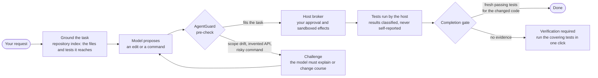
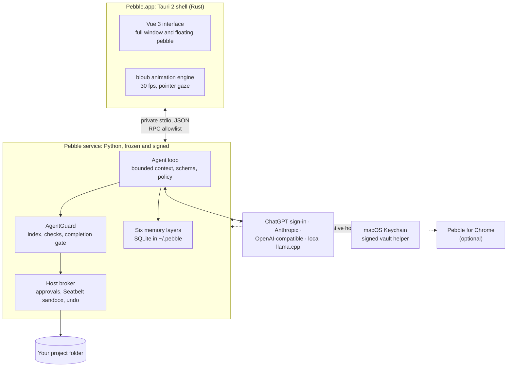

<div align="center">


# Pebble

### The desktop companion that does real work, and shows its evidence.

A small animated pebble lives on your Mac. Click it to chat, or open the full window to work in a project, read the web,
keep memory you control and build interactive views, with the model you choose. **AgentGuard**, built in, makes
"done" mean the work was checked, not just claimed.

[](https://github.com/tohin003/Pebble/releases/latest)
[](#install)
[](LICENSE)
[](#built-like-infrastructure)
[](#agentguard-evidence-before-done)

[**Download for macOS**](https://github.com/tohin003/Pebble/releases/latest/download/Pebble-macos-arm64.zip) ·
[One-line install](#install) · [User guide](docs/USER_GUIDE.md) · [What's new](CHANGELOG.md) ·
[Architecture](docs/ARCHITECTURE.md)

<br>


<sub>The companion as Pebble's own animation engine draws it. Its eyes follow your pointer.</sub>

</div>

---

## Install

You need a Mac with Apple silicon (M1 or later) and macOS 12 or later. In Terminal:

```sh
curl -fsSL https://raw.githubusercontent.com/tohin003/Pebble/main/install.sh | bash
```

The installer checks the download's SHA-256, keeps any earlier `Pebble.app` in `~/PebbleBackups`, never uses `sudo`,
never changes Gatekeeper and never touches your data. [What it does, step by step](#what-the-installer-does), by hand
or for a specific version.

---

## Why Pebble

<table>
<tr>
<td width="33%" valign="top">

### 🪨 A companion, not a terminal

Pebble sits on your desktop as a small, living character. Ask it something in a click, or open the full window when a
task needs room. One app covers chat, projects, the web, documents and your apps.

</td>
<td width="33%" valign="top">

### 🛡️ Evidence before "done"

AgentGuard grounds every coding task in your repository. It challenges drift and invented dependencies, and holds a run
that changed code until the tests it reaches have passed.
[How it works ↓](#agentguard-evidence-before-done)

</td>
<td width="33%" valign="top">

### 🔌 Your model, your choice

Sign in with ChatGPT, add an Anthropic or any OpenAI-compatible key, or run a GGUF model on your Mac with the bundled
llama.cpp. Switch per conversation.

</td>
</tr>
<tr>
<td valign="top">

### 🧠 Memory you can see

Six kinds of memory you can search, edit in plain words (`~/.pebble/PEBBLE.md`) and forget one by one, or switch off.
Recalled memory is labelled data, never instructions.

</td>
<td valign="top">

### 🔒 Private by default

Your conversations live on your Mac, with readable copies in `~/Documents/Pebble`. No telemetry. Keys stay in the
Keychain. A local conversation reaches a cloud model only after you review it.

</td>
<td valign="top">

### 🧪 Built like infrastructure

1.0.1 passed 8,421 tests and 1,772 service checks, on source and on the frozen app. Its backend build is reproducible,
and the release passed a full licence inventory and a secret scan.

</td>
</tr>
</table>

---

## AgentGuard: evidence before "done"

Left alone, a model decides for itself when a task is finished. In Pebble, a separate engine reads the evidence first.
[AgentGuard](backend/vendor/agentguard) (Apache-2.0) is built in as a **verification layer**. It indexes your project,
then grounds the request in the files it actually reaches. It checks each proposed change against that, and it reads
test results only as the host observed them, never as the model reports them.



| What happens | What a model alone might do | What Pebble does |
|---|---|---|
| A bug fix quietly rewrites six unrelated helpers | Keep going | **Challenges** at the sixth write: "5 file(s) changed that the task does not reach" |
| The model calls a function that does not exist in your code | Write it in anyway | **Challenges** the invented API, so the model must look it up or change course |
| The model says "fixed, all tests pass" | Report done | **Holds** the run at "verification required" until the host has seen the covering tests pass |
| A lint or build pass is offered as proof | Count it | **Does not count it:** only a test run is evidence |
| "No tests" appears somewhere in the request | Skip the tests | **Skips them only** for an explicit "don't run the tests" |
| The project index is still building | Allow and hope | **Waits**, and says "verification unavailable" instead of a silent allow |

AgentGuard makes Pebble more **reliable**, not more secure. It is not a sandbox. Safety comes from Pebble's host:
- approvals happen only in the main window;
- commands run in macOS's Seatbelt sandbox with no shell features;
- nothing a model, web page, file or generated view says can widen what Pebble may do.

[docs/ARCHITECTURE.md](docs/ARCHITECTURE.md) has the full design.

---

## Under the hood



<details>
<summary><b>The six memory layers</b></summary>

| Layer | What it keeps | Who writes it |
|---|---|---|
| Working context | Current goal, recent goals, what Pebble observed | Pebble, per conversation |
| Episodic | Past requests and recorded action outcomes | Pebble records (up to 1,500 automatic episodes) |
| Semantic | Facts and knowledge you save | You, personal or per project |
| Procedural | Workflows and procedures you save | You; guidance only, never permission to act |
| Temporal | Dated information that expires | Pebble or you, always with an expiry |
| Profile | Your preferences and personal context | You; removable |

</details>

<details>
<summary><b>Everything Pebble does</b></summary>

[The user guide](docs/USER_GUIDE.md) covers each of these in detail.

- **Chat** with the model you choose, in the full window or from the pebble. Replies show what Pebble did and how long
  it took; ⌘. stops a task.
- **Work in a project.** Connect a folder and Pebble can:
  - read it;
  - propose edits, each one a card you approve, with Undo;
  - run its tests in an isolated copy;
  - run terminal commands under review;
  - prepare Git changes for you to approve.
- **Permissions.** Three modes, **Ask for approval** (the default), **Auto in project** and **Full access**, plus a switch
  for each kind of tool. Approvals happen only in the main window.
- **The web.**
  - Searches send your search words to Microsoft Bing (its RSS results feed).
  - Pages Pebble reads are fetched from their own sites.
  - Weather comes from Open-Meteo.
  - Everything read from the web is treated as untrusted data.
- **Memory.** Six kinds of memory you can see, search, edit in your own words (`~/.pebble/PEBBLE.md`) and forget, with
  one switch to turn it off.
- **Views.** Ask for a dashboard, a chart, a quiz or an app demo, and Pebble builds it from data. A view can show and
  collect things, but it can never approve, run or change anything.
- **Bigger tasks.** Pebble can split work across agents, track a goal with criteria, and run reviewed schedules while
  it is open. Type `/` in the message box for its commands.
- **Skills and connectors.** Add reusable instructions (skills) and MCP connectors in **Settings › Skills & connectors**.
- **Pebble for Chrome** lets Pebble look at and act in a Chrome tab you share and grant, one site at a time. It is
  loaded in Chrome's Developer mode for 1.0; see [the user guide](docs/USER_GUIDE.md#pebble-for-chrome).

</details>

---

## Built like infrastructure

Pebble is built to the standard of software that people trust with their projects:

| | |
|---|---|
| **Tests** | 8,421 automated tests at v1.0.1, none skipped. They never call a model or the network. |
| **Service checks** | 1,772 checks across 40 validator suites, each run against the source *and* the frozen, signed app |
| **Reproducible build** | The shipped backend is byte-identical to the tested one, apart from its signature |
| **Release gates** | Secret scan, licence inventory (366 components, every notice present), a scan for personal paths, and every published test run in a fresh clone |
| **Safe updates** | The installer keeps the previous app. Database upgrades back up first. Every release is rehearsed on a copy of real data and drilled with a rollback before it ships. |

---

## Benchmarks: measured, not claimed

Next, Pebble goes head to head against **Claude Code CLI** on the same Claude models, and against **Codex CLI** on GPT
models:
- **The corpus:** a 60-task graded set covering bug fixes, features, refactors and traps.
- **AgentGuard ablation:** separately, the same tasks with AgentGuard on, off and observe-only.
- **Rules:** every run is registered before it starts, every cell is counted, and nothing is projected.

The results and charts will appear here and in [docs/PEBBLE_V1_BENCHMARKS.md](docs/PEBBLE_V1_BENCHMARKS.md) when the
runs finish. Until then, this README makes no claim about which agent is better.

---

## Install in detail

### What the installer does

```sh
curl -fsSL https://raw.githubusercontent.com/tohin003/Pebble/main/install.sh | bash
```

The installer:

- runs only on macOS on Apple silicon, not under Rosetta, and refuses a macOS older than the app needs;
- downloads `Pebble-macos-arm64.zip` and `SHA256SUMS` from the latest GitHub release over HTTPS only, into a new private
  temporary folder, and checks the zip's SHA-256 against its line in `SHA256SUMS`;
- unpacks it there and checks the app's identifier (`com.pebble.local`), version and code signature before it changes
  anything;
- stops if Pebble is running (it never quits or kills anything);
- moves an existing `Pebble.app` to `~/PebbleBackups/<time>-pre-install.noindex/Pebble.app.backup` (it never deletes
  one);
- installs into `/Applications` if your account can write there, otherwise into `~/Applications`;
- removes only the temporary folder it created for the download, and never touches your data (`~/.pebble`,
  `~/Documents/Pebble`);
- never uses `sudo`, never changes Gatekeeper and never removes quarantine flags.

Options, added after `bash -s --`:

```sh
curl -fsSL https://raw.githubusercontent.com/tohin003/Pebble/main/install.sh | bash -s -- --dry-run          # show what it would do; nothing changes
curl -fsSL https://raw.githubusercontent.com/tohin003/Pebble/main/install.sh | bash -s -- --version 1.0.1    # a specific release
curl -fsSL https://raw.githubusercontent.com/tohin003/Pebble/main/install.sh | bash -s -- --uninstall        # move the app aside; see below
```

To read the installer before running it, download it first:
1. `curl -fsSL -o install.sh https://raw.githubusercontent.com/tohin003/Pebble/main/install.sh`
2. Read it.
3. Run `bash install.sh`.

### Install by hand

1. From the [latest release](https://github.com/tohin003/Pebble/releases/latest), download `Pebble-macos-arm64.zip` and
   `SHA256SUMS` into the same folder.
2. In Terminal, in that folder: `shasum -a 256 -c SHA256SUMS`. It should print `Pebble-macos-arm64.zip: OK`.
3. Double-click the zip and drag `Pebble.app` to Applications.
4. The first time you open it, macOS may say it cannot verify the app. That's because a file downloaded in a browser is
   quarantined, and Pebble is not notarized (see below). Allow Pebble alone:
   - Control-click `Pebble.app`, choose **Open**, then **Open** again.
   - On recent macOS versions, open **System Settings › Privacy & Security** and click **Open Anyway** next to the
     message about Pebble.

   Never turn Gatekeeper off.

### Signing, honestly

- Pebble is signed with the project's own stable signing identity ("Pebble Local Signing"), not an Apple Developer ID,
  and it is **not notarized** by Apple. The identity stays the same from release to release, so a Keychain **Always
  Allow** you give once normally carries over to later updates.
- `SHA256SUMS` is not signed, and it comes from the same release as the zip. Checking it shows that the download
  arrived intact; it does **not** prove who made it (integrity, not authenticity).
- The installer downloads with curl, which does not quarantine files, so macOS opens Pebble without the warning above.

### First run

1. Open Pebble from Applications or Spotlight.
   - The first time, with no model connected, the full window opens with a welcome: **Connect your ChatGPT account** or
     **Use a local model**.
   - After that, Pebble starts as the pebble. Click it to chat, and use its arrow (or open Pebble again) to bring up the
     full window.
2. Connect a model in **Settings › Models** (⌘,):
   - **Continue with ChatGPT** signs in with your ChatGPT account in your browser. It needs an eligible Plus or Pro plan
     through OpenAI's preview for open-source and approved clients; plan limits apply, and API billing is separate.
   - **Connect provider** adds an API key for an OpenAI-compatible service (OpenAI, Ollama, LM Studio and others), an
     Anthropic key, or a Responses API endpoint.
   - **Add a model file** runs a GGUF model on your Mac with the bundled llama.cpp. Pebble downloads no model by itself;
     [docs/MODEL_SELECTION.md](docs/MODEL_SELECTION.md) names the default the project tests with (about 2.8 GB).
3. If macOS asks whether Pebble may use its item in your Keychain, enter your login password and choose **Always
   Allow**. Your sign-ins and keys are kept there, never in Pebble's files.

### Update

1. Quit Pebble and run the installer again. It keeps the previous app in `~/PebbleBackups` and leaves your data where it
   is.
2. When an update changes how Pebble stores its data, Pebble first backs up its database in
   `~/.pebble/data/upgrade-backups/`.

Pebble 1.0 does not check for updates by itself: watch the [releases](https://github.com/tohin003/Pebble/releases) and
read [CHANGELOG.md](CHANGELOG.md).

### Uninstall

```sh
curl -fsSL https://raw.githubusercontent.com/tohin003/Pebble/main/install.sh | bash -s -- --uninstall
```

This moves `Pebble.app` to `~/PebbleBackups/<time>-uninstall.noindex/` and lists what Pebble keeps on your Mac. Your
data is never touched. "Remove Pebble completely" in [docs/DATA_FOLDERS.md](docs/DATA_FOLDERS.md) says what each folder
holds and how to remove everything, including the Keychain items.

---

## Your data and privacy

- **Where your data lives:**
  - `~/.pebble` holds Pebble's database, settings, `PEBBLE.md` and logs.
  - `~/Documents/Pebble` holds readable copies of your conversations, memories and files, which you can turn off.
  - Passwords, keys and sign-ins stay in the macOS Keychain.

  [docs/DATA_FOLDERS.md](docs/DATA_FOLDERS.md) lists everything, what is safe to delete, and how deletion works.
- **What leaves your Mac:**
  - the request to the model provider you chose (your message and the context Pebble sends with it);
  - searches to Bing;
  - the pages and weather you ask for;
  - calls to connectors you add.

  With a local model, the conversation stays on your Mac. A conversation you had with a local model is not sent to a
  cloud model unless you review and release it.
- **No telemetry.** Pebble sends no analytics. Optional usage counters are off by default, stay on your Mac, and can be
  exported or cleared.
- **Pebble's own tools** can never read or change `~/.pebble` or `~/Documents/Pebble`, even when your project contains
  them.

## Build it yourself

[BUILDING.md](BUILDING.md) builds Pebble from a clean clone with Node, Rust 1.99.0, Python 3.14 and the Xcode Command
Line Tools. [CONTRIBUTING.md](CONTRIBUTING.md) explains how changes are tested: tests never call a model or the network,
and earlier phases' tests and validators are never weakened.

## Limits

- macOS on Apple silicon only. No Windows or Linux release.
- Not notarized and no automatic updates (see above). No independent security audit has been done.
- Models make mistakes, including confident ones.
  - AgentGuard checks evidence such as test runs. It is not a security layer, and it cannot make every answer right.
  - Commands and parsers run in macOS's `sandbox-exec`, which limits them but is not a promise against every attack.
  - Prompt injection from web pages or files is limited, not impossible.
- Web search depends on Bing's RSS feed, which may change or stop without notice. The free Open-Meteo service is for
  non-commercial use.
- Pebble for Chrome needs Chrome's Developer mode, and Pebble's own built-in browser is not available yet.
- Scheduled tasks run only while Pebble is open.

## Security, licence and credits

- **Security:** report a vulnerability privately, as [SECURITY.md](SECURITY.md) describes.
- **Licence:** Pebble is licensed under the [Apache License 2.0](LICENSE). Community standards are in
  [CODE_OF_CONDUCT.md](CODE_OF_CONDUCT.md).
- **Built with:**
  - [AgentGuard](backend/vendor/agentguard) (Apache-2.0), the verification engine;
  - **bloub** (MIT), the companion's animation engine;
  - [Tauri](https://tauri.app), [Vue](https://vuejs.org) and [llama.cpp](https://github.com/ggml-org/llama.cpp).

  [NOTICE.md](NOTICE.md) lists all third-party software.

<div align="center"><sub>Made with care for people who want an assistant they can check.</sub></div>
