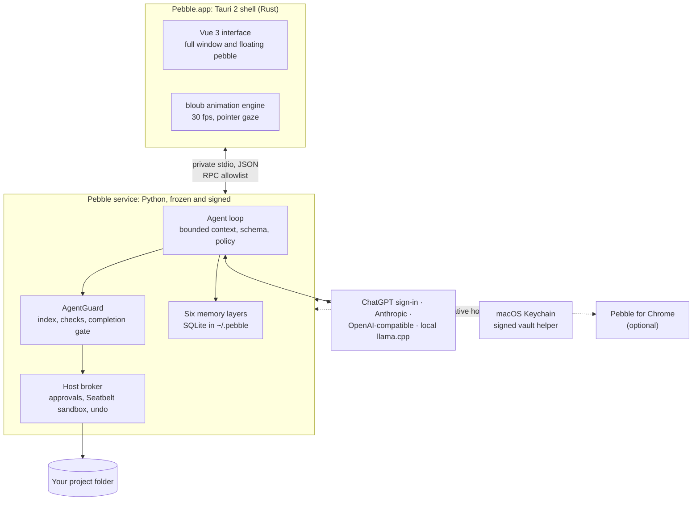
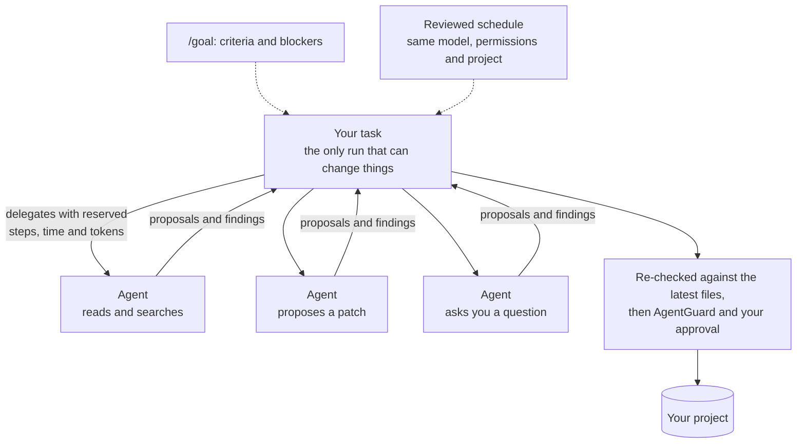
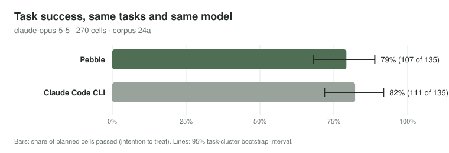
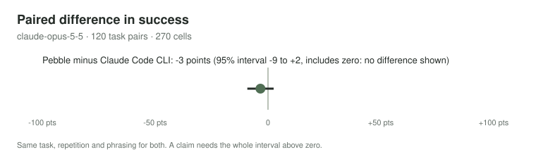

<div align="center">


# Pebble

### The desktop companion that does real work, and shows its evidence.

A small animated pebble lives on your Mac. Click it to chat, or open the full window to work in a project, read the web,
keep memory you control and build interactive views, with the model you choose. **AgentGuard**, built in, makes
"done" mean the work was checked, not just claimed.

[](https://github.com/tohin003/Pebble/releases/latest)
[](#install)
[](LICENSE)
[](#built-like-infrastructure)
[](#agentguard-evidence-before-done)

[**Download for macOS**](https://github.com/tohin003/Pebble/releases/latest/download/Pebble-macos-arm64.zip) ·
[One-line install](#install) · [User guide](docs/USER_GUIDE.md) · [What's new](CHANGELOG.md) ·
[Architecture](docs/ARCHITECTURE.md)

<br>


<sub>The companion as Pebble's own animation engine draws it. Its eyes follow your pointer.</sub>

</div>

---

## Install

You need a Mac with Apple silicon (M1 or later) and macOS 12 or later. In Terminal:

```sh
curl -fsSL https://raw.githubusercontent.com/tohin003/Pebble/main/install.sh | bash
```

The installer checks the download's SHA-256, keeps any earlier `Pebble.app` in `~/PebbleBackups`, never uses `sudo`,
never changes Gatekeeper and never touches your data. [What it does, step by step](#what-the-installer-does), by hand
or for a specific version.

---

## Why Pebble

<table>
<tr>
<td width="33%" valign="top">

### 🪨 A companion, not a terminal

Pebble sits on your desktop as a small, living character. Ask it something in a click, or open the full window when a
task needs room. One app covers chat, projects, the web and documents, and opens your apps when you approve.

</td>
<td width="33%" valign="top">

### 🛡️ Evidence before "done"

AgentGuard grounds every coding task in your repository. It challenges drift and invented dependencies, and holds a run
that changed code until the tests it reaches have passed.
[How it works ↓](#agentguard-evidence-before-done)

</td>
<td width="33%" valign="top">

### 🔌 Your model, your choice

Sign in with ChatGPT, add an Anthropic or any OpenAI-compatible key, or run a GGUF model on your Mac with the bundled
llama.cpp. Switch at any time; the choice applies to every conversation.

</td>
</tr>
<tr>
<td valign="top">

### 🧠 Memory you can see

Six kinds of memory you can search and forget one by one, or switch off, plus `~/.pebble/PEBBLE.md` in your own
words. Recalled memory is labelled data, never instructions.

</td>
<td valign="top">

### 🔒 Private by default

Your conversations live on your Mac, with readable copies in `~/Documents/Pebble`. No telemetry. Keys stay in the
Keychain. A local conversation reaches a cloud model only after you review it.

</td>
<td valign="top">

### 🧪 Built like infrastructure

1.5.0 passed 9,097 tests and 1,948 service checks, on source and on the frozen app. Its backend build is reproducible,
and the release passed a full licence inventory and a secret scan.

</td>
</tr>
</table>

---

## See it

<div align="center">

<picture><source media="(prefers-color-scheme: dark)" srcset="https://raw.githubusercontent.com/tohin003/Pebble/media/readme/01-hero.png"></picture>

<sub>The main window, with the pebble beside it.</sub>

</div>

<table>
<tr>
<td width="50%"><picture><source media="(prefers-color-scheme: dark)" srcset="https://raw.githubusercontent.com/tohin003/Pebble/media/readme/02-project-edit.png"></picture><br><sub><b>Edits wait for you.</b> A fix proposed as two reviewed edit cards, in "Ask for approval".</sub></td>
<td width="50%"><picture><source media="(prefers-color-scheme: dark)" srcset="https://raw.githubusercontent.com/tohin003/Pebble/media/readme/03-agentguard.png"></picture><br><sub><b>AgentGuard holds the task.</b> Two files changed and no test ran, so "done" waits: run the tests, finish, or accept it as unverified.</sub></td>
</tr>
<tr>
<td width="50%"><picture><source media="(prefers-color-scheme: dark)" srcset="https://raw.githubusercontent.com/tohin003/Pebble/media/readme/04-memory.png"></picture><br><sub><b>Memory you can see.</b> Six layers, each record with where it came from, and Forget on every one.</sub></td>
<td width="50%"><picture><source media="(prefers-color-scheme: dark)" srcset="https://raw.githubusercontent.com/tohin003/Pebble/media/readme/05-views.png"></picture><br><sub><b>Views.</b> A live dashboard built from your words, opened in the canvas.</sub></td>
</tr>
</table>

<div align="center">

<picture><source media="(prefers-color-scheme: dark)" srcset="https://raw.githubusercontent.com/tohin003/Pebble/media/readme/06-pebble-gaze.gif"></picture>

<sub>Every name, file, number and conversation in these captures is synthetic demo data. The windows are Pebble 1.0.1's
own interface.</sub>

</div>

### Stealth Lockdown

<div align="center">

<picture><source media="(prefers-color-scheme: dark)" srcset="https://raw.githubusercontent.com/tohin003/Pebble/media/readme/07-stealth-veil.gif"></picture>

<sub>The Veil, rendered frame by frame from Pebble 1.2's own avatar code (a protected window can't be screen-recorded).</sub>

</div>

One switch for presenting, calls and screen shares. Turn it on in Settings → Privacy and focus, from the menu-bar
icon, or with ⌃⌥⌘S.

- **Stealth.** Pebble's windows are left out of screen capture and screen sharing. Pebble leaves the Dock, ⌘Tab and
  Mission Control. ⌃⌥⌘H hides every Pebble window at once, and the menu-bar icon brings it back.
- **Lockdown.** Pebble never takes focus from the app in front. You can type to it while your slides or call stay
  active.
- **You can always tell it's on.** The pebble wears the Veil, a dusk-blue glass with a light rim, and the menu-bar icon
  changes shape.

> Hidden from screen capture and screen sharing, not from a camera, a capture card or a process list. Exams and
> interviews that forbid assistants still forbid it.

---

## AgentGuard: evidence before "done"

Left alone, a model decides for itself when a task is finished. In Pebble, a separate engine reads the evidence first.
[AgentGuard](https://github.com/tohin003/Pebble/tree/main/backend/vendor/agentguard) (Apache-2.0) is built in as a **verification layer**. It indexes your project,
then grounds the request in the files it actually reaches. It checks each proposed change against that, and it reads
test results only as the host observed them, never as the model reports them.


| What happens | What a model alone might do | What Pebble does |
|---|---|---|
| A bug fix quietly rewrites six unrelated helpers | Keep going | **Challenges** at the sixth write: "5 file(s) changed that the task does not reach" |
| The model calls a function that does not exist in your Python code | Write it in anyway | **Challenges** the invented API, so the model must look it up or change course (Python projects; other languages aren't checked yet) |
| The model says "fixed, all tests pass" | Report done | **Holds** the run at "verification required" until the host has seen the covering tests pass |
| A lint or build pass is offered as proof | Count it | **Does not count it:** only a test run is evidence |
| "No tests" appears somewhere in the request | Skip the tests | **Skips them only** for an explicit "don't run the tests" |
| The project index is still building | Allow and hope | **Waits**, and says "verification unavailable" instead of a silent allow |

AgentGuard makes Pebble more **reliable**, not more secure. It is not a sandbox. Safety comes from Pebble's host:
- approvals happen only in the main window;
- commands run in macOS's Seatbelt sandbox with no shell features;
- nothing a model, web page, file or generated view says can widen what Pebble may do.

[docs/ARCHITECTURE.md](docs/ARCHITECTURE.md) has the full design.

---

## Under the hood



## Memory in six layers

Pebble remembers the way a good colleague does: separately for what you told it, what it learned, how things are done,
what happened before, what expires, and where the current task stands. Every layer is visible, searchable and yours
to forget.

```mermaid
flowchart LR
    subgraph You["You decide"]
        S["Settings › Memory<br/>see · search · forget"]
        F["PEBBLE.md<br/>in your own words"]
        X["One switch<br/>memory off"]
    end
    subgraph Layers["Six layers, on your Mac"]
        P["Profile<br/>your preferences"]
        K["Semantic<br/>facts and knowledge"]
        R["Procedural<br/>how things are done here"]
        E["Episodic<br/>past tasks and outcomes"]
        T["Temporal<br/>things that expire"]
        W["Working<br/>the current task"]
    end
    You --> Layers
    Layers --> Q["Recall for this task<br/>labelled as data, with origin and date"]
    Q --> M(["The model's context<br/>within its token budget"])
```



| Layer | In Pebble | What it holds | Who writes it |
|---|---|---|---|
| **Profile** | Your preferences | How you like to work. "Remember that I …" saves one right away. | You; removable |
| **Semantic** | Facts & knowledge | Facts about your projects and the world | Pebble (from evidence) or you; personal or per project |
| **Procedural** | Procedures | How things are done here, such as how a project's tests run | Pebble (from evidence) or you; guidance only, never permission to act |
| **Episodic** | Past experiences | What earlier tasks asked for and how they went | Pebble (up to 1,500 automatic episodes) |
| **Temporal** | Time-sensitive information | Dates and temporary arrangements, each with an expiry | Pebble or you, always with an expiry |
| **Working** | Working context | Where the current conversation's task stands | Pebble, per conversation |

Recalled memory reaches the model as **labelled data, never as instructions**: a memory can inform an answer but can
never grant a permission. `PEBBLE.md`, which you write, is the exception: Pebble follows it as your standing
instructions, and it grants no permission either. Asking Pebble to forget something shows the matching memories in the
main window, and nothing goes until you confirm. A memory you forget is not learnt again from the same place;
**Forget all** starts over, so Pebble can learn again.

---

## Orchestration: agents, goals and schedules

Big tasks don't have to be one long chat. Pebble splits work, tracks it and runs it on a schedule, without giving up
control.



- **Bounded agents.** A task can hand parts to agents. Each one gets steps, seconds and tokens reserved from the parent
  task, and a reduced tool set: it can read, search, ask and propose. Agents never change your project, run commands
  or call connectors themselves; an agent in its own worktree writes only in that copy. The main task reviews each
  proposal, re-checks it against the latest files, and applies it through AgentGuard and your normal approval. You can
  see every agent's work, send it input or stop it.
- **Goals with criteria.** `/goal "title"` gives a conversation a checklist: criteria you tick off or tie to finished
  steps (`/criteria`), and blockers Pebble records (`/blockers`). A goal tracks progress; it is never a permission.
- **Reviewed schedules.** A conversation can set up a task that runs at set times, with the model, permissions and
  project you approved. Results appear in Details › Tools, and as macOS notifications once you turn those on. If the
  model or permissions change, the schedule waits for your review again.
- **Recoverable runs.** If Pebble quits mid-task, it marks what was interrupted and asks before anything resumes.
  **Rewind files** puts back what a task changed, unless the files changed since, and lists what it cannot undo.

---

## Everything else Pebble does

<table>
<tr>
<td width="33%" valign="top">

**📊 Views and exports**<br>
Ask for a dashboard, chart, plan, diagram, quiz or app demo. Pebble builds it as a live view and keeps its earlier
versions. Export to Word, Excel, CSV or HTML. A view can show and collect things, never approve or run them.

</td>
<td width="33%" valign="top">

**🔎 Research with sources**<br>
Search the web and read the pages behind the answer. Sources are listed and open in your browser, and everything read
online is treated as untrusted data.

</td>
<td width="33%" valign="top">

**💻 Projects and Git**<br>
Edits arrive as reviewable cards with Undo. Tests run in an isolated copy, and commands run sandboxed without a shell.
Git commits and branches come to you as a plan to approve.

</td>
</tr>
<tr>
<td valign="top">

**🧩 Skills, hooks and connectors**<br>
Reusable skills in Markdown, hooks that can narrow (never widen) what a task does, and MCP connectors over HTTP with
OAuth. Each starts off until you review it.

</td>
<td valign="top">

**🌐 Pebble for Chrome**<br>
Share a Chrome tab and grant it, and Pebble can look at it and act in it on that one site; every press asks first. It
cannot open, close or switch tabs.

</td>
<td valign="top">

**🔀 Local and cloud, with a handoff**<br>
Run a GGUF model on your Mac with llama.cpp, or a cloud model. A conversation you had on your Mac reaches a cloud model
only after you review and release it.

</td>
</tr>
<tr>
<td valign="top">

**📎 Documents and images**<br>
Drop in PDFs, documents and screenshots. Images are cleaned of metadata and scaled before they reach a model.

</td>
<td valign="top">

**⌨️ Fast to drive**<br>
A command palette, `/` commands in the message box, and ⌘. to stop a task. ⌘+ and ⌘− set the text size, and
keyboard shortcuts cover the main actions.

</td>
<td valign="top">

**🪨 The companion**<br>
A real-time animated character that shows what Pebble is doing: reading, searching, editing, testing, done. Its eyes
follow your pointer. Reduced motion is respected.

</td>
</tr>
</table>

The [user guide](docs/USER_GUIDE.md) covers each feature in detail.

---

## Built like infrastructure

Pebble is built to the standard of software that people trust with their projects:

| | |
|---|---|
| **Tests** | 9,097 automated tests at v1.5.0, none skipped. They never call a model or the network. |
| **Service checks** | 1,948 checks across 51 validator suites, each run against the source *and* the frozen, signed app |
| **Reproducible build** | The shipped backend is byte-identical to the tested one, apart from its signature |
| **Release gates** | Secret scan, licence inventory (366 components, every notice present), a scan for personal paths, and every published test run in a fresh clone |
| **Safe updates** | The installer keeps the previous app. Database upgrades back up first. Every release is rehearsed on a copy of real data and drilled with a rollback before it ships. |

---

## Benchmarks: measured, not claimed

**Pebble against Claude Code CLI, both on Claude Opus 5.5: no difference shown.** On the same 45 tasks, three
repetitions each, Pebble 1.0.2 passed 79.3 % and Claude Code 82.2 %. The paired difference is −3.3 points, with a 95 %
interval of −9.2 to +2.5. Pebble was ahead on multi-turn tasks, and behind on coding fixes and research. Its lead on
clarification tasks is overstated: the harness missed two clarifying questions Claude Code asked, so their follow-ups
were never sent ([correction](docs/PEBBLE_V1_BENCHMARKS.md#corrections-after-publication)).

<p align="center">


</p>

- **How it ran:**
  - Each run was registered before its first task.
  - Every task counts, and only a pass is success. A claim needs the whole interval above zero.
  - Both products used the same model and effort, the same tasks, phrasing and turns, and the same 15-minute limit.
- **What it cost:** at Anthropic's list prices, about $0.085 a task for Pebble and $0.053 for Claude Code. Pebble sent
  fewer tokens, but almost none came from the prompt cache. 1.3.0 makes each request extend the previous one so the
  cache can be used, and 1.4.0 seals a long task's older tool results in large chunks; their effect is measured in the
  next benchmark.
- **What it found:** a real Pebble bug on Claude (multi-step tasks could fail on their third request), fixed in 1.0.2
  before the counted run.

Everything is in [docs/PEBBLE_V1_BENCHMARKS.md](docs/PEBBLE_V1_BENCHMARKS.md#5b-pebble-against-claude-code-cli-24a-claude-opus-55):
the setup, every family, the cost, the harness fixes, and the cases to read with care. Codex CLI on GPT models and the
AgentGuard ablation are still to come. This README claims nothing they have not measured.

---

## Install in detail

### What the installer does

```sh
curl -fsSL https://raw.githubusercontent.com/tohin003/Pebble/main/install.sh | bash
```

The installer:

- runs only on macOS on Apple silicon, not under Rosetta, and refuses a macOS older than the app needs;
- downloads `Pebble-macos-arm64.zip` and `SHA256SUMS` from the latest GitHub release over HTTPS only, into a new private
  temporary folder, and checks the zip's SHA-256 against its line in `SHA256SUMS`;
- unpacks it there and checks the app's identifier (`com.pebble.local`), version and code signature before it changes
  anything;
- stops if Pebble is running (it never quits or kills anything);
- moves an existing `Pebble.app` to `~/PebbleBackups/<time>-pre-install.noindex/Pebble.app.backup` (it never deletes
  one);
- installs into `/Applications` if your account can write there, otherwise into `~/Applications`;
- removes only the temporary folder it created for the download, and never touches your data (`~/.pebble`,
  `~/Documents/Pebble`);
- never uses `sudo`, never changes Gatekeeper and never removes quarantine flags.

Options, added after `bash -s --`:

```sh
curl -fsSL https://raw.githubusercontent.com/tohin003/Pebble/main/install.sh | bash -s -- --dry-run          # show what it would do; nothing changes
curl -fsSL https://raw.githubusercontent.com/tohin003/Pebble/main/install.sh | bash -s -- --version 1.0.1    # a specific release
curl -fsSL https://raw.githubusercontent.com/tohin003/Pebble/main/install.sh | bash -s -- --uninstall        # move the app aside; see below
```

To read the installer before running it, download it first:
1. `curl -fsSL -o install.sh https://raw.githubusercontent.com/tohin003/Pebble/main/install.sh`
2. Read it.
3. Run `bash install.sh`.

### Install by hand

1. From the [latest release](https://github.com/tohin003/Pebble/releases/latest), download `Pebble-macos-arm64.zip` and
   `SHA256SUMS` into the same folder.
2. In Terminal, in that folder: `shasum -a 256 -c SHA256SUMS`. It should print `Pebble-macos-arm64.zip: OK`.
3. Double-click the zip and drag `Pebble.app` to Applications.
4. The first time you open it, macOS may say it cannot verify the app. That's because a file downloaded in a browser is
   quarantined, and Pebble is not notarized (see below). Allow Pebble alone:
   - Control-click `Pebble.app`, choose **Open**, then **Open** again.
   - On recent macOS versions, open **System Settings › Privacy & Security** and click **Open Anyway** next to the
     message about Pebble.

   Never turn Gatekeeper off.

### Signing, honestly

- Pebble is signed with the project's own stable signing identity ("Pebble Local Signing"), not an Apple Developer ID,
  and it is **not notarized** by Apple. The identity stays the same from release to release, so a Keychain **Always
  Allow** you give once normally carries over to later updates.
- `SHA256SUMS` is not signed, and it comes from the same release as the zip. Checking it shows that the download
  arrived intact; it does **not** prove who made it (integrity, not authenticity).
- The installer downloads with curl, which does not quarantine files, so macOS opens Pebble without the warning above.

### First run

1. Open Pebble from Applications or Spotlight.
   - The first time, with no model connected, the full window opens with a welcome: **Connect your ChatGPT account** or
     **Use a local model**.
   - After that, Pebble starts as the pebble. Click it to chat. Its arrow opens the full workspace in full screen, with
     the Dock out of the way; Floating companion, the red button or ⌘W bring you back to the pebble. Opening Pebble
     again brings up the window as you left it.
2. Connect a model in **Settings › Models** (⌘,):
   - **Continue with ChatGPT** signs in with your ChatGPT account in your browser. It needs an eligible Plus or Pro plan
     through OpenAI's preview for open-source and approved clients; plan limits apply, and API billing is separate.
   - **Connect provider** adds an API key for an OpenAI-compatible service (OpenAI, Ollama, LM Studio and others), an
     Anthropic key, or a Responses API endpoint.
   - **Add a model file** runs a GGUF model on your Mac with the bundled llama.cpp. Pebble downloads no model by itself;
     [docs/MODEL_SELECTION.md](docs/MODEL_SELECTION.md) names the default the project tests with (about 2.8 GB).
3. If macOS asks whether Pebble may use its item in your Keychain, enter your login password and choose **Always
   Allow**. Your sign-ins and keys are kept there, never in Pebble's files.

### Update

1. Quit Pebble and run the installer again. It keeps the previous app in `~/PebbleBackups` and leaves your data where it
   is.
2. When an update changes how Pebble stores its data, Pebble first backs up its database in
   `~/.pebble/data/upgrade-backups/`.

Pebble 1.0 does not check for updates by itself: watch the [releases](https://github.com/tohin003/Pebble/releases) and
read [CHANGELOG.md](CHANGELOG.md).

### Uninstall

```sh
curl -fsSL https://raw.githubusercontent.com/tohin003/Pebble/main/install.sh | bash -s -- --uninstall
```

This moves `Pebble.app` to `~/PebbleBackups/<time>-uninstall.noindex/` and lists what Pebble keeps on your Mac. Your
data is never touched. "Remove Pebble completely" in [docs/DATA_FOLDERS.md](docs/DATA_FOLDERS.md) says what each folder
holds and how to remove everything, including the Keychain items.

---

## Your data and privacy

- **Where your data lives:**
  - `~/.pebble` holds Pebble's database, settings, `PEBBLE.md` and logs.
  - `~/Documents/Pebble` holds readable copies of your conversations, memories and files, which you can turn off.
  - Passwords, keys and sign-ins stay in the macOS Keychain.

  [docs/DATA_FOLDERS.md](docs/DATA_FOLDERS.md) lists everything, what is safe to delete, and how deletion works.
- **What leaves your Mac:**
  - the request to the model provider you chose (your message and the context Pebble sends with it);
  - searches to Bing;
  - the pages and weather you ask for;
  - calls to connectors you add.

  With a local model, the conversation stays on your Mac. A conversation you had with a local model is not sent to a
  cloud model unless you review and release it.
- **No telemetry.** Pebble sends no analytics. Optional usage counters are off by default, stay on your Mac, and can be
  exported or cleared.
- **Pebble's own tools** can never read or change `~/.pebble` or `~/Documents/Pebble`, even when your project contains
  them.

## Build it yourself

[BUILDING.md](BUILDING.md) builds Pebble from a clean clone with Node, Rust 1.99.0, Python 3.14 and the Xcode Command
Line Tools. [CONTRIBUTING.md](CONTRIBUTING.md) explains how changes are tested: tests never call a model or the network,
and earlier phases' tests and validators are never weakened.

## Limits

- macOS on Apple silicon only. No Windows or Linux release.
- Not notarized and no automatic updates (see above). No independent security audit has been done.
- Models make mistakes, including confident ones.
  - AgentGuard checks evidence such as test runs. It is not a security layer, and it cannot make every answer right.
  - Commands and parsers run in macOS's `sandbox-exec`, which limits them but is not a promise against every attack.
  - Prompt injection from web pages or files is limited, not impossible.
- Web search depends on Bing's RSS feed, which may change or stop without notice. The free Open-Meteo service is for
  non-commercial use.
- Pebble for Chrome needs Chrome's Developer mode. It has been tested against a simulated Chrome so far, not yet end
  to end in a real one. Pebble's own built-in browser and control of other apps' windows are not available yet.
- Scheduled tasks run only while Pebble is open.

## Security, licence and credits

- **Security:** report a vulnerability privately, as [SECURITY.md](SECURITY.md) describes.
- **Licence:** Pebble is licensed under the [Apache License 2.0](LICENSE). Community standards are in
  [CODE_OF_CONDUCT.md](CODE_OF_CONDUCT.md).
- **Built with:**
  - [AgentGuard](https://github.com/tohin003/Pebble/tree/main/backend/vendor/agentguard) (Apache-2.0), the verification engine;
  - **bloub** (MIT), the companion's animation engine;
  - [Tauri](https://tauri.app), [Vue](https://vuejs.org) and [llama.cpp](https://github.com/ggml-org/llama.cpp).

  [NOTICE.md](NOTICE.md) lists all third-party software.

<div align="center"><sub>Made with care for people who want an assistant they can check.</sub></div>
